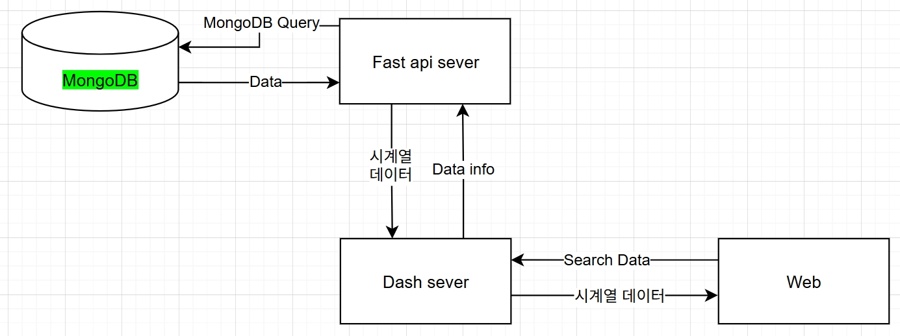

# Timeseries Management Dashboard (Dash + FastAPI + MongoDB)

본 프로젝트는 **공정 데이터 관리 및 관리상한도** 시각화를 위한  
Dash + FastAPI 기반 웹 대시보드 애플리케이션입니다.

MongoDB에 저장된 공정 데이터를 FastAPI로 가져와 CSV로 변환하고,  
Dash에서 WebGL 기반 Plotly 그래프를 통해 실시간으로 분석합니다.

---

## 아키텍쳐



## 주요 구성
사내 데이터 관련으로 핵심 코드 비공개

| 구성 요소 | 설명 |
|------------|------|
| **FastAPI** | MongoDB에서 데이터를 조회하고 CSV로 저장 (UC3, UC4 지원) |
| **Dash** | WebGL 기반 관리도 대시보드 UI |
| **MongoDB** | 공정 데이터 원본 저장소 |
| **shared_data/** | FastAPI에서 생성한 CSV 파일 저장 경로 |

---

## 프로젝트 설정

### MogoDB .env 설정
```
MONGO_USER=your_mongo_user
MONGO_PASS=your_mongo_password
MONGO_PORT=27017
MONGO_AUTH_DB=admin
MONGO_DB=your_database_name
```
---

### 통합 서버 구동
```
python run_all.py
```

`run_all.py` 파일로 FastAPI, ploter 서버를 모두 구동하며, 상세한 설정은 해당 파일에서 수정 후 실행.
